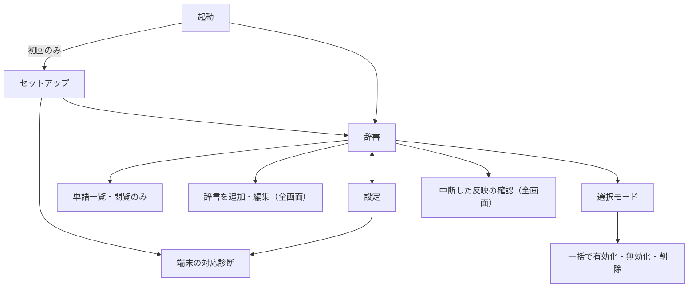

# 03 画面・操作

現行要件は[01](01-requirements.md)を参照。実装は `app/src/main/java/me/midra/dictionarysync/ui/`。

## 用語

| 用語 | 意味 |
|---|---|
| 辞書 | アプリに登録した辞書ファイル（名前・URL・形式などの設定と取得済みの単語）。端末の「ユーザー辞書」とは常に書き分ける。コード上の名前は source |
| 取得 | 配布元からダウンロードし、解析してアプリ内に保存すること |
| 反映 | 取得済みの単語を端末のユーザー辞書（共有ユーザー辞書）へ書き込むこと |
| 同期 | 取得と反映の両方。自動同期・「今すぐ同期」・「すべて同期」はこの意味 |
| 中断した反映 | 途中で止まった反映（旧称: 未完了の計画）。続きを反映・再反映・取り消しから選ぶ |
| 対応診断 | キーボードの有効化、確認用の単語での読み取り、テスト用の単語での書き込みの3手順 |

## 画面構成

ナビゲーションのトップは「辞書」「設定」の2つ。Navigation 3のバックスタックで管理し、プロセス再生成後も復元する。

- 幅600dp未満: 下部に `ShortNavigationBar`（トップレベル画面のみ表示）。
- 幅600dp以上: 左に `WideNavigationRail`。
- 初回起動のセットアップ中は、どちらも表示しない。幅が十分なとき（list-detailの判定による）は単語一覧を辞書一覧の右に表示する。
- 左右に並べたときは、間のドラッグハンドルで幅を変えられる（辞書一覧を狭く・半分ずつ・単語一覧を狭く、の3段階に吸着）。単語一覧の戻るボタンは出さず、戻る操作では単語一覧を閉じて案内表示に戻す。レールと両ペインは同じ背景色にする。
- 遷移アニメーションはMaterial 3 Expressiveのモーション（テーマの `MotionScheme` のスプリング）に合わせる。トップレベル間とセットアップ完了はフェードスルー、単語一覧（狭い画面）と対応診断は共有軸X（戻るときは逆向き）、予測型「戻る」では閉じる画面が縮んで指の方向へ寄る。折りたたみ・展開などで同じ画面の配置だけが変わるときはクロスフェードにする。左右に並べた単語一覧の開閉はlist-detailのペインアニメーションに任せる。

追加・編集と中断した反映の確認はViewModelの状態で開く全画面ダイアログで、回転や再生成後も開いたまま入力を保持する。

## 辞書

- 上部: `TopAppBar`。サブタイトルに全体の状態（「4件 · すべて正常」「4件 · 2件を確認してください」「4件 · 処理中」）。操作は「すべて同期」と「選択」（どちらもアイコン、ツールチップあり）。
- 主操作: 拡張FAB「辞書を追加」。スクロールすると縮む。幅600dp以上ではレール上部のFAB（アイコンとツールチップ）になり、設定画面から押した場合は辞書一覧に切り替えてからフォームを開く。登録数に上限はない。
- お知らせ（該当時のみ、一覧の先頭）:
  - 中断した反映がある: 「確認する」で確認画面を開く。確認するまでほかの辞書の反映は待機する。
  - 操作はトーンの強調色で塗ったボタンにし、本文と見分けられるようにする。
  - 有効な辞書があり、反映の準備ができていない（「キーボードの有効化が必要です」「ユーザー辞書への反映には対応診断が必要です」「対応診断が完了していません」）: 「診断を開く」。取得と閲覧はそのまま使えることを併記する。
- 各辞書（セグメント化したリスト項目）:
  - 名前
  - 「5,708語 · 24時間ごと · 3時間前に更新」（未取得なら「未取得 · 24時間ごと」。無効の辞書は自動同期しないため間隔を出さない）
  - 状態を1行だけ（アイコン＋文言。色だけで伝えない。アイコンは文字サイズに合わせて拡大する）。問題がある場合は短い理由を2行目に表示し、取得の失敗・中断では「前回取得したデータを引き続き使用しています」を添える。
  - 有効／無効のスイッチ、「その他の操作」メニュー（今すぐ同期・編集・削除）
  - 取得中・反映中は波形の進捗表示
- 読み込み中は `LoadingIndicator`、0件なら図形付きの空状態を表示する。

### 状態の優先順位

1辞書につき、上から最初に当てはまる1つを表示する（`ui/sources/SourcePresentation.kt`）。

| 状態 | 表示 |
|---|---|
| 削除処理が失敗 | 削除が完了していません。メニューから再試行できます |
| 取得中 | 取得中 |
| 反映が中断（要確認） | 反映が中断しています |
| 反映中・中断から自動再開待ち | ユーザー辞書に反映中 |
| 反映失敗 | ユーザー辞書に反映できませんでした＋理由 |
| 取得失敗 | 取得できませんでした＋理由＋前回のデータを使用中である旨 |
| 通信条件待ち／配布元の待機指示／再試行待ち／待機中 | 各待機の表示（期限があれば日時） |
| 取得が中断 | 取得が中断されました＋前回のデータを使用中である旨 |
| 削除を反映中 | ユーザー辞書から削除中 |
| 無効（ユーザー辞書から外す処理を待機中） | ユーザー辞書から外す処理を待機中 |
| 無効 | 無効 |
| 未取得 | 未取得 |
| 前回の反映を取り消し済み | 前回の反映を取り消しました |
| 反映待ち | ユーザー辞書への反映待ち |
| 反映済み | ユーザー辞書に反映済み |
| その他 | ユーザー辞書に未反映 |

内部のエラーコードは短い理由に置き換えて表示し、コード自体はエラーダイアログ・フォーム・確認画面で補足として示す。

### 最終更新の表示規則

- 1時間未満は「1時間以内に更新」。
- 1〜24時間（24時間ちょうどを含む）は、時間未満を切り捨てた「n時間前に更新」。
- 24時間を超えたら端末タイムゾーンの日時（例: `2026/10/28 14:30に更新`）。未来時刻（時計変更）も日時で表示する。
- 304で保存済みデータを再利用した場合も取得確認の時刻へ更新する。取得失敗時は前回の時刻・件数を保持する。

### 操作

- 行をタップすると単語一覧。スイッチは画面遷移を起こさない。
- 「選択」または長押しで選択モード。上部は「n件選択中」と終了ボタン、「すべて選択」（すべて選択済みなら「選択を解除」に切り替わる1つのボタン。大きな文字でも件数を1行に収めるため）。下部のフローティングツールバーに「有効化」「無効化」「削除」（アイコン＋ラベル）。選択中はスイッチとメニューを操作できない。
- 有効化・無効化・削除は、画面では希望する状態を保存するだけで、ユーザー辞書への書き込みはバックグラウンドで行う（06）。待機中・反映中は各行の状態に表示する。
- 有効化・無効化は確認なしで実行し、件数をスナックバーで表示する（「2件を有効にしました」「2件を無効にしました」、削除は「2件の削除を開始しました」）。一部が実行できなかった場合は「n件は完了し、m件は実行できませんでした」。受け付けられなかった辞書（例: 中断した反映があるため）は理由をダイアログで示し、選択したまま残す。削除は対象数を示して1回だけ確認する。
- 選択モード外でスイッチを1件切り替えた場合は通知せず、結果は行の状態で示す。
- ユーザー辞書への書き込みに失敗した辞書は、メニューの「反映を再試行」で再び順番待ちに入れられる（診断を完了した後など）。

## 辞書を追加・編集

全画面のフォーム。上部に閉じる（キャンセル）と「追加」／「保存」ボタン。ダイアログのウィンドウでもステータスバー・ナビゲーションバーのアイコン色をテーマ（ライト／ダーク）に合わせる（中断した反映の確認も同じ）。

- 名前・辞書ファイルのURL（1行入力）。URLの補足に「https:// で始まる、ファイルを直接取得できるURL」。
- URL欄のキーボードの「完了」でも追加／保存できる（名前とURLが入力済みの場合）。
- 自動同期の間隔は連結したトグルボタン（1時間・6時間・12時間・24時間・3日・7日）。幅や文字サイズのため収まらない場合は残りをオーバーフローメニューへ移し、メニューでは選択中の間隔にチェックを付ける。オーバーフローボタンは未選択のボタンと同じ色にし、選択中に見えないようにする。
- 詳細設定は開閉式。追加時は閉じた状態で「形式: 自動 · 言語: 自動 · 文字コード: 自動」のように現在の値を要約し、編集時と、形式・言語・文字コードに関するエラーで失敗した場合は開いた状態にする。
- 形式・言語・文字コードはドロップダウン。選択中の項目はチェックで示し、項目の文字位置は揃える。形式の各項目と文字コードの「自動」には短い説明を付ける。言語で「言語タグを指定」を選ぶとタグ入力欄を表示し、言語が「自動」のときは欄の補足に「言語情報のないファイルは日本語として扱います」と示す。
- 取得中は進捗表示と「取得して内容を確認しています」、「取得を中止」を表示し、入力と保存を止める。閉じる・戻る操作も取得の中止になり、フォームと入力は残る。
- 失敗時はフォームを閉じず、先頭に理由とエラーコードを表示し、関係する入力欄をエラー表示にする。入力はすべて保持する。配布元の待機指示がある場合は期限を表示する。
- 編集時は「URL・形式・言語・文字コードを変えた場合、取得に成功するまでは今の設定とデータを使い続けます」と表示する。

入力途中の内容はダイアログの外側で保存しており、回転・再生成・プロセス再生成でも残る。

## 単語一覧

`TopAppBar`（サブタイトル付き）に辞書名と「5,708語 · 日本語 · 閲覧のみ」、戻る・編集ボタン。検索欄（単語・読み）はアプリバーの下に固定してスクロールしても隠さず、アプリバーと同じ面に置く（一覧が下に入ると両方の色が一緒に変わる）。

- 単語は辞書一覧と同じセグメント化したリスト（`surfaceContainer`）。各行は、読みを単語の上にふりがなのように小さく強調色で、単語を強調書体で、コメントを3行までその下に表示する。読みもコメントもない単語は余分な行を出さない。
- 品詞は行の右にラベルで示す。言語は単語ごとの解決済み言語で、1種類ならサブタイトルに表示し、複数（Gboardの混在辞書など）なら「3言語」とし各行の右に言語ラベル（例: 英語（イギリス））を付ける。同じ単語・読みでも言語が違えば別の単語として反映されるため、重複に見えないようにする。
- 列が足りず読み飛ばした行がある場合は、情報アイコン付きの注記を先頭に表示する。
- 読み込み中・エラー・0件・一致なしを区別して表示する。0件・一致なし・エラーは図形とアイコン付き（未選択時の案内表示と同じ形）。
- 追加・編集・削除・同期除外の操作はない。

## 中断した反映の確認

全画面。対象辞書、件数（反映後の単語・追加・対象外になる単語・削除・共通の単語・保護・保留）、停止理由、注意事項、すべての差分（検索可）を1画面にまとめる。主ボタンは目的に応じて「続きを反映」「再反映を実行」「取り消しを実行」「削除を実行」。未承認の反映だけ「この反映を取り消す」を表示する。承認済みで要確認の反映には「関連辞書をまとめて再反映する」「今回の反映を取り消して元に戻す」を説明付きで示す。

## 初回セットアップ

初回起動時だけ、辞書一覧の前に「はじめに」を表示する。手順は対応診断と同じカードで示す。

1. バックグラウンドでの実行を許可する（設定の「バックグラウンドと通知」と同じ、電池の最適化からの除外）。
2. 同期の通知を許可する。
3. ユーザー辞書への反映を準備する（現在の診断状態、対応診断を開く。戻るとセットアップへ戻り、状態を読み直す）。

下部の「はじめる」はいつでも押せる。未完了の項目がある場合は「どれもあとから設定画面で行えます。」と添える。押すと完了を保存し（DataStore）、以後は辞書一覧から起動する。取得・閲覧の前提にはしない。

## 設定

- 同期: Wi-Fiのみで取得（行全体が1つのスイッチ）、端末の対応診断（現在の状態を表示。診断から戻るたびに読み直す）。
- バックグラウンドと通知: 電池の最適化から除外（現在の状態を表示。最適化の対象ならOSの除外確認ダイアログ、除外済みなら最適化の一覧を開く）。画面に戻るたびに状態を読み直す。どの端末にもある設定だけを置き、端末やOSの版によって有無が異なる制限は扱わない。同期の通知（許可の状態を表示。未許可なら許可を求め、以後はアプリの通知設定を開く）。
- このアプリについて: 説明とバージョン、ライセンス（同梱のライセンス本文を表示。80桁で折り返された原文を段落ごとにつなぎ直し、インデントと前後の空行を除いて画面幅で折り返す）。

## 端末の対応診断

3つの手順をカード（影を付けないトーナルな面。ほかのリストと同じ `surfaceContainer`）で示し、完了した手順の番号は丸から別の図形へ変形して完了を示す。

1. キーボードを有効にする（現在の有効状態、キーボード設定を開く）。
2. 確認用の単語（`dictionarysync_check_`＋8桁の16進数。アプリ名で由来がわかるようにする）を登録して読み取る（単語のコピー、ユーザー辞書の設定を開く、登録した旨のチェック、読み取りの確認、結果）。
3. 書き込みを確認する（確認ダイアログの後に実行、結果）。手順2が済むまでは理由を表示して無効にする。

未完了の診断記録がある場合だけ、照合（読み取りのみ）と後始末を表示する。診断記録は開閉式で、等幅で表示する。診断が完了している場合は先頭に表示する。

## レイアウトと利用しやすさ

- 上部のアプリバーは標準サイズの`TopAppBar`で（単語一覧では検索欄を含めた上部全体で）、スクロールしても隠さず固定する（`pinnedScrollBehavior`。内容が下に入ると色だけ変わる）。
- テーマ: Android 12以上はDynamic Color、それ未満はアイコンの色から作った配色（ライト／ダーク）。`MotionScheme.expressive()`。起動時のウィンドウ背景も昼夜で切り替える。
- エッジツーエッジ。キーボード表示中もフォームはスクロールして操作できる。
- TalkBack: スイッチは「辞書名、有効／無効」、選択中の行は「辞書名、選択済み／未選択」。アイコンだけのボタンにはラベルとツールチップ。見出しを設定。拡張FABはアイコンの説明で読み上げる。読み込み中の表示にも説明を付ける。
- 触覚フィードバック: スイッチの切り替え、長押しで選択開始、一括操作・診断の成功／失敗。
- 文字サイズ200%・狭い画面（320dp）・広い画面のPreviewを `ui/preview` に用意している。
