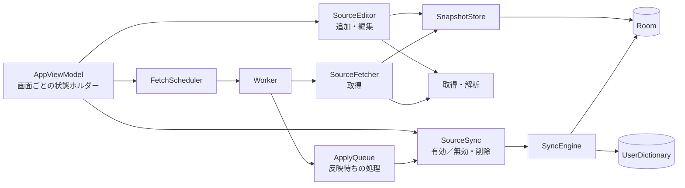

# 04 アーキテクチャ・実装方針

01・03の操作を実現する構成を定義する。

## 構造と責務

単一appモジュールを維持する。既存のKotlin・Coroutines・Flow、Compose・Material 3 Expressive、Room、DataStore、Paging、WorkManagerを使い、追加のDI基盤や汎用ジョブエンジンを導入しない。部品の組み立ては `AppContainer`（手書きの依存関係グラフ、プロセスに1つ）で行い、Worker・ViewModelはそこから部品を受け取る。試験は同じコンストラクタにメモリ上のDB・偽の取得・偽Providerを渡して組み立てる。

| 部品 | 責務 |
|---|---|
| `AppViewModel` と状態ホルダー | 画面ごとの状態（`SourceListState`・`EntriesState`・`SourceFormState`・`SettingsState`・`SyncReviewState`）を1つのViewModelに持つ。ユーザー操作は共有の `Operations` で1つずつ実行し、実行中は他の操作を無効にする。状態の表示規則は `ui/sources/SourcePresentation.kt` の純粋関数 |
| `SourceEditor` | 追加・編集。入力（`SourceDraft`）を検証し、取得に関わる設定なら取得・解析してからSourceと取得版を1回のトランザクションで保存する |
| `SourceFetcher` | 登録済みソースの取得要求の実行、条件付き取得と304、失敗時の待機・再試行の記録 |
| `SnapshotStore` | 取得版（Snapshot）と単語の保存、不要な版の削除、304で再利用できる版の検証 |
| `SourceSync` | ソースの希望状態（有効・無効・削除）と、それを共有辞書に反映する計画の作成・実行・復旧 |
| `ApplyQueue` | 反映待ちのソースを `SourceSync` で1件ずつ反映する（反映チェーンの本体） |
| `FetchScheduler` / `FetchWork` | 保存済みの要求をWorkManagerの作業として登録し、保存と登録の間の欠落を起動時に補う |
| `SyncEngine` / `SyncRecoveryEngine` | 有効ソースの参照を照合し、アプリ管理行だけを差分反映。操作記録による再開・復旧 |
| Downloader / Parser | HTTPS取得、対応形式の解析。DB・Provider・UIから独立 |
| Room | ソース設定、取得済み単語、最終更新時刻、同期用の参照・操作記録 |
| DataStore | Wi-Fiのみ設定。ソースの間隔や言語はRoomに保存 |

### 状態の型

ソース・計画・操作記録・取得要求の状態はKotlinのenum（`SourceLifecycle`・`FetchState`・`SyncState`・`PlanState`・`PlanPurpose`・`Ownership`・`OperationKind`・`OperationPhase`・`FetchOutcome`・`WaitReason`）で扱う。Roomは名前で保存するため、定数名はschemaの一部であり、変更せず追加だけを行う。変換は `StateConverters` が行い、この版が知らない名前（新しい版が書いた値を、旧版に戻した後に読む場合など）は、自動処理を止める側の値として読む（例: 計画は「要確認」、所有権は「不明」として削除しない）。SQLに状態名を直接書かず、DAOの引数としてenumを渡す。理由コード（`SyncStopped`・`DictionaryProblem` の `code`）は利用者への説明と問い合わせ用の文字列のまま扱う。

### 変更してはいけない名前

インストール済みの端末が保持している名前は、変更すると既存の登録が失われる。

- Worker のクラス名（`sync.FetchWorker`・`ApplyWorker`・`FetchWakeWorker`・`PeriodicFetchWorker`）と一意な作業名（`FetchWork` の定数）。WorkManagerがDBに保存している
- IMEサービス `ime.DictionaryProbeIme`。利用者がOSの設定で有効にしたキーボードとして記録されている
- `DictionaryDatabase` のクラス名（schemaの出力先）、DataStoreとファイル（`noBackupFilesDir` 内）の名前

## 追加・編集・一括処理

フォームの入力値は登録済みSourceと分離する。取得・解析はDBトランザクションの外で行い、成功時にSource・Snapshot・Entryを1回のRoomトランザクションで保存する。失敗時に削除して帳尻を合わせるための仮登録は不要。保存後に定期実行と共有辞書への反映を開始する。

編集も同じ取得・保存処理を使う。名前・間隔のみの編集は通信不要。選択したソースの一括有効化・無効化・削除は個別処理を順に呼び、結果をソースごとに返す。全選択を1つの大きなトランザクションや補償処理にまとめない。

## 通信と解析

- 標準のHTTPSクライアントとTLS検証を使用する。URLクエリを組み替えず、リダイレクト先で元の保存URLを上書きしない。
- 既存のタイムアウト（接続15秒・読込30秒・全体120秒）、最大5リダイレクト、転送・展開後20 MiB上限を継続する（100,000語の辞書はUTF-16やAppleの字下げ付きplistで10 MiBを超えるため）。上限は資源保護であり、新たな細目検証を増やす根拠にしない。
- 対応形式を全体解析してから採用する。取得・復号・解析失敗なら旧データを保持する。正常な0件と通信失敗の空本文は区別する。
- HTTP validator（ETag・Last-Modified）による条件付き取得と304、上限付きの再試行とRetry-Afterに対応する（`data/source/HttpRetry.kt`）。取得は `DictionaryDownload` を通して行い、試験ではこれを差し替える。
- Wi-Fiのみ設定を初回取得・手動同期・定期同期へ同じように適用する。設定待ちを初回追加の成功としない。

## 性能と保存

通信・解析・大量DB操作はUIスレッドの外で行う。単語一覧は既存のPagingと検索を使い、全単語を一度にUIへ読み込まない。ソース別の設定・最終更新・件数は一覧表示用クエリで取得する。

容量は20ソース、1取得版100,000項目、アプリが共有辞書に追加する行は合計200,000件（ソースを全面的に差し替える間の新旧の和集合を含む）までとする。新たな細かい文字数制限や複雑な容量予約機構は追加しない。

所有権DB・操作記録はバックアップ対象から除外する既存方針を維持する。ログにURLのクエリ値や辞書本文を大量記録しない。未完了の共有辞書操作が参照するデータは途中で削除しない。

反映の計画・実行・復旧では、計画と操作記録に含まれるキーだけを読み込む（キーの表は過去のキーも保持し続けるため、全件は読み込まない）。

復旧の同意後に参照（`source_references`）が変わったことは、SQLiteのトリガーが更新する世代番号（`reference_generation`）で検出する。以前は境界ごとに全参照のハッシュを計算しており、復旧が「キー数×参照数」に比例していた。

反映は最大900語のまとまり（古いAndroidのSQLiteの変数上限999未満）ごとに進める。アクセス確認（キーボードの有効状態・Providerの指紋・確認用の単語）と計画の有効性の確認はまとまりごとに1回行い、Providerの照会は1語ずつではなく`_id IN (...)`・`word IN (...)`でまとめて行う。以前は1語ごとにアクセス確認を約6回・`word = ?`の全表走査を2回・個別トランザクションを5回以上行っており、100,000語では数時間かかる計算だった。診断の証明書と記録は同じロックの中でしか書かれないため、1回の操作につき1度だけ読む。

操作記録の書き方は次のとおり。追加と削除はまとまりの全件を1トランザクションで`IN_FLIGHT`として記録してから呼び出す。追加の返却IDは呼び出しごとに直ちに記録する（返却IDを失うと所有を証明できないため）。削除の結果はまとめて記録する（中断しても行の読み戻しで完了・未実行を判定できるため）。返却IDのない`IN_FLIGHT`の追加は、一致する行がなければ呼び出しが効果を持たなかったことが確かなので、検索し直してから再実行する。一致する行があれば自分の行か判定できないため、従来どおり結果不明として止める。

内容が変わらない同期でも、外部で編集・削除された単語を検出するための照合は省略しない。照合は書込前に全キーについて行い、追加後・削除後の再照合は、その反映で共有辞書やbindingに何かを書いた場合だけ行う（何も書いていなければ直前の照合と同じ結果になるため）。すでに確認済みで変化のない操作記録は書き直さない。自動同期では確認画面用のプレビューを作らない。

取得版は、最新・1つ前・反映中の版と、未完了の計画が参照する版だけを残す。完了した計画は計画行と操作記録を残すが、取得版や計画ごとのキー集合（`plan_keys`）は保持し続けない。validatorのない配布元でも取得のたびにDBが増えないようにするため。
